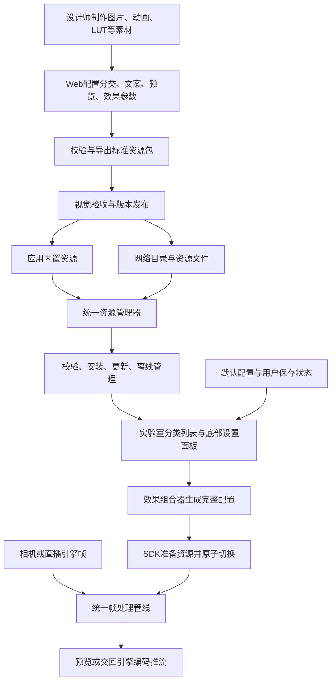

# 美颜特效资源完整流程与实施方案

- 日期：2026-10-27
- 状态：公共资源闭环已落地；Android/Web已执行回归，iOS源码待Apple环境编译验收。
- 适用：Web 制作端、Android/iOS 资源消费端、实验室、相机和直播引擎宿主。
- 下文保留目标设计。实际V1格式与接入以resources/unified/v1/README.md和Schema为准；新packageVersion独立封装旧V1～V4执行payload。

## 1. 目标与完整闭环

让同事通过 Web 制作和交付资源，让应用按分类展示内置及网络资源，让 SDK 使用同一套资源与参数处理不同来源的视频帧。



闭环完成需要制作、发布、管理、加载和处理五部分联通。实验室是参考使用端；正式应用无需依赖实验室 UI，能够调用相同公共能力。

SDK 不负责启动直播、音频、账号或编码。资源系统不保存或上传人脸帧。不同引擎仍各自需要薄适配层，负责帧格式、坐标、线程、生命周期与交回接口。

## 2. 四类交付对象

| 对象 | 含义 | 是否开启效果 |
| --- | --- | --- |
| 单项资源 Resource | 一款睫毛、一副眼镜、一种滤镜或一组参数预设 | 用户选择后才应用 |
| 组合套装 Theme | 明确搭配的一组资源和参数 | 选择后整套替换 |
| 默认配置 Defaults | 默认语言、初始参数、默认资源与面板排序 | 首次使用或恢复默认时采用 |
| 发布目录 Catalog | 可展示资源的分类、文案、封面、版本、地址、大小和摘要 | 只用于发现，不自动应用 |

“完整主题包”是一套搭配，不是必须下载的全量素材库。完整资源库由目录管理很多单项资源及套装，支持按需安装。离线交付可以额外提供多个包及目录的集合，但不改变单项包协议。

主题采用自包含交付：包内带所引用的单项资源和锁定的摘要，不依赖安装时再寻找未知版本。导入后按摘要去重复用。第一版不允许主题嵌套主题、循环引用或任意层级 ZIP。

## 3. 分类与效果槽位

| 分类标识 | 展示名称 | 子分类示例 | 默认组合规则 |
| --- | --- | --- | --- |
| BEAUTY | 美颜 | 磨皮、美白、红润 | 按参数键组合，一个键一个最终值 |
| RESHAPE | 美型 | 瘦脸、大眼、鼻、下巴、嘴 | 按参数键组合 |
| MAKEUP | 美妆 | LIPSTICK、BLUSHER、EYELASH、EYELINER、EYESHADOW、EYEBROW | 不同部位叠加，同部位单选 |
| FILTER | 滤镜 | 色调、LUT | 第一版单选 |
| STICKER | 贴纸 | 眼镜、胡子、帽子、装饰、动画 | 不同槽位叠加；同槽位单选 |
| BACKGROUND | 背景 | 虚化、图片、视频 | 单选 |
| MOTION | 运镜 | 推拉、平移、摇摆、跟随 | 第一版单选时间轴 |
| THEME | 套装 | 自然、日常、创意等 | 整套替换后允许用户再调整 |

分类用于 UI 与管理，effectType 用于执行，slot 用于互斥，两者不能混用。比如 MAKEUP / EYELASH 对应 makeup.eyelash 槽位，其底层可能仍与口红共用一次 GPU 合成。

所有类别和子类有稳定 ID、多语言名称、排序。分类出现不代表该设备支持全部效果；不支持的资源显示原因并禁止应用。视频背景、动画、眼影等在没有对应执行器前不能标记可用。

资源参数拥有明确作用域。睫毛资源只能改变睫毛槽位及其强度，不得用零值顺便清除用户的口红或磨皮。套装才允许声明完整替换。

## 4. 单项资源协议草案

建议引入独立 Resource Package V1 外层，保留旧 effect payload 的版本；不继续把列表信息混进算法配置。完整 JSON Schema 在实施阶段与解析器、共同夹具一起交付。

```text
lash_natural.zip
├─ manifest.json
├─ preview.png
├─ effect.json
└─ textures/
   └─ eyelash.png
```

```json
{
  "packageVersion": 1,
  "id": "lash_natural",
  "revision": 1,
  "category": "MAKEUP",
  "subcategory": "EYELASH",
  "slot": "makeup.eyelash",
  "defaultLocale": "zh-CN",
  "name": "自然款睫毛",
  "description": "自然纤长的日常睫毛",
  "localizations": {
    "en": {"name": "Natural lashes", "description": "Natural everyday lashes"}
  },
  "preview": "preview.png",
  "effect": "effect.json",
  "requirements": {
    "features": ["face.landmarks478", "makeup.eyelash.texture.v1"]
  }
}
```

- id 是长期身份，revision 是递增发布修订号；packageVersion 是协议版本，两者不混用。
- 下载文件 SHA-256 放在发布目录，不写入包含自身的 manifest，避免自引用摘要问题。
- effect.json 带 effectVersion、effectType 及严格参数。素材路径全部相对包根，禁止外部 URL、绝对路径、脚本及可执行代码。
- preview 是资源列表封面，不参与视频合成。建议统一正方形封面，制作端另提供真实佩戴预览；示意人像不能冒充真人效果验收。
- 不含图片的磨皮参数预设，也有名称、封面及 effect.json。
- 可选作者、标签、授权说明在正式 Schema 中明确字段与限制，不允许任意未知字段静默通过。
- 参数描述包含键、类型、范围、中性值、默认值、步长及显示名称。显示配置不能自行改变执行器允许的安全范围。

## 5. 多语言与默认配置

资源文案和宿主界面文案分开管理。资源名称、说明、分类名称走资源元数据；按钮、错误提示等宿主文案由 Android/iOS UI 国际化处理。资源不能强制修改宿主系统语言。

语言解析：宿主显式指定语言（未指定则系统语言）→ 对应父语言 → 资源 defaultLocale → manifest.name。实现需处理语言/脚本/地区标签，不把 zh-Hant 错配为简体。缺少某一字段翻译时逐字段回退。

```json
{
  "defaultsVersion": 1,
  "defaultLocale": "zh-CN",
  "localeMode": "FOLLOW_HOST",
  "enabled": true,
  "parameters": {
    "beauty.smoothing": 0.35,
    "beauty.whitening": 0.2
  },
  "selections": {
    "makeup.eyelash": null,
    "filter": null,
    "background": null,
    "motion": null
  },
  "categoryOrder": ["BEAUTY", "RESHAPE", "MAKEUP", "FILTER", "STICKER", "BACKGROUND", "MOTION", "THEME"]
}
```

这是精简示例；未写参数取 SDK 明确的中性值，不使用不确定的历史状态。非空 selection 指向资源 ID 与锁定 revision/摘要，正式 Schema 采用结构化引用。

状态合并顺序：SDK 中性值 → 默认 JSON → 用户已保存状态 → 宿主本次显式覆盖。仅对写明字段覆盖；用户主动关闭必须保存显式 null/disabled，不能在重启后误用默认值重新开启。

- 默认资源应随应用内置或提前安装。启动不等待网络；缺失时只关闭对应槽位并报告原因。
- 远端更新默认配置不自动覆盖老用户选择。宿主显式升级或用户“恢复默认”后才采用新配置。
- 单项关闭只清当前槽位；分类重置只重置该分类；恢复全部默认重新解析当前默认配置。
- 应用套装替换全部效果状态，未声明槽位归中性；之后修改某项显示“已自定义”，保存完整结果，避免套装标识与真实状态不一致。

## 6. 发布目录与发布流程

目录每项至少包含 ID、revision、分类/子分类、名称及翻译、封面 URL、包 URL、字节数、SHA-256、能力要求和排序。封面需能独立获取，列表不能为了显示图片先下载整个 ZIP。

目录 metadata 与包内 manifest 必须一致；安装时复核身份、修订号与分类，不能只相信列表文案。摘要防止损坏或拿错内容；其可信性依赖宿主配置的可信目录来源，不把摘要宣称为数字签名。

发布流程：制作 → 静态校验 → SDK 视觉与能力验收 → 生成不可变版本文件/封面 → 上传文件 → 验证可下载 → 最后更新目录。禁止同一个已发布 revision 悄悄替换内容。

目录刷新失败保留上次有效缓存，离线继续展示已安装资源。撤下资源停止新下载；已安装资源不被后台无提示删除。内置及远端同 ID/同 revision 不同摘要视为冲突，不能按访问顺序覆盖。

## 7. 统一资源管理器

三类来源：BUILTIN（应用 assets/bundle）、LOCAL（用户选择文件）、REMOTE（可信目录中的下载项）。统一返回 ResourceDescriptor 和安装状态。Android/iOS共享行为协议，平台文件与 HTTP 实现分别提供。

```text
beauty_resources/
├─ catalogs/                   # 最近有效目录及封面缓存
├─ staging/<operationId>/      # 下载、校验、临时展开
├─ installed/<sha256>/         # 已校验不可变内容
├─ index.json                  # ID、revision、摘要、来源、安装状态
└─ user-state.json             # 用户选择和参数；不属于可清理下载缓存
```

安装状态：NOT_INSTALLED → DOWNLOADING/COPYING → VERIFYING → INSTALLING → INSTALLED；任一步可 FAILED 或 CANCELLED。运行时 ACTIVE、PREPARING、UNSUPPORTED 单独管理，不能用“已下载”冒充“已生效”。

1. 后台复制或下载到 staging，不在主线程/视频回调操作。
2. 限制输入大小，核对预期长度与 SHA-256；内置和本地导入也执行相同内容校验。
3. 校验协议、路径、图片/动画/LUT格式、累计解码预算和能力声明。
4. 按需展开到临时安装目录；拒绝 Zip Slip、符号链接、重复路径、大小写冲突及解压炸弹。
5. 全部成功后在同一文件系统原子提交目录和安装索引；中断恢复可扫描已完成记录，绝不把半包列为可用。
6. 输出只读资源句柄。已安装内容按摘要复用，安装操作并发去重，取消一个订阅不取消其他使用者的共享下载。

小图可从保留的 ZIP 直接解码，大文件/流式媒体使用已展开文件；采用何种方式由执行器决定，对 UI 保持统一 API。主题内资源去重需要引用计数，不能删除仍被其他套装使用的内容。

支持进度、取消、失败重试；首版可以失败后完整重下，断点续传是单独增强项，不在未实现时宣称支持。新版成功准备并切换后再释放旧版；未完成 GPU 工作仍持有旧资源。

清理分为临时文件、未使用安装资源和用户状态；“清缓存”默认不清用户选择或内置默认资源。卸载活动资源需先关闭/替换并等待引用释放，再删除文件。

## 8. 公共模块和 API 职责

以下是建议接口职责，不是已存在的签名：

| 组件 | 责任 | 不负责 |
| --- | --- | --- |
| ResourceCatalog | 合并内置/网络目录、语言解析、分类筛选 | 渲染、相机 |
| BeautyResourceManager | 导入/下载/安装/查询/卸载、只读句柄 | UI、帧处理 |
| BeautyDefaultsResolver | 默认 JSON 与用户状态迁移、合并、重置 | 网络自动应用 |
| BeautyEffectComposer | 槽位互斥、参数作用域、套装应用、能力校验 | 资源下载 |
| BeautySession / Pipeline | 准备并应用快照、处理视频帧、报告性能 | 资源列表页面 |
| 实验室 ViewModel | 调用上述服务、映射进度与当前状态 | 自建第二套资源解析器 |
| 引擎适配器 | 转换引擎帧契约并交回输出 | 复制资源管理逻辑 |

建议新增独立 core/lib_beauty_resources 负责平台资源管理，依赖核心 API；JSON协议类型可放该库或独立纯模型层。lib_beauty 不反向依赖资源库、UI、WKQ、网络客户端或厂商 SDK。宿主通过 Transport 接口注入 HTTP，联网权限属于宿主。

默认配置生成完整不可变 EffectState，资源准备完成后通过同一 Session 入口发布。公开结果必须区分安装成功、准备成功和应用成功，并返回稳定错误码与本地化友好文案。

## 9. 实验室交互流程

1. 初始化 Session 与资源管理器，加载内置目录、默认 JSON 和本机状态。
2. 立即恢复可用的已安装资源；后台刷新网络目录，保持画面可用。
3. 相机画面为主体，底部弹框展示一级分类、子分类和资源网格。
4. 每项展示名称、封面、选中态、下载/更新/失败/不支持状态；当前参数效果使用滑杆。
5. 点击未安装资源：下载并显示进度，当前效果继续工作；点击已安装资源直接准备。
6. 准备成功后一次切换并更新选中态、持久化；失败保留旧画面，支持重试。
7. 快速连续点击时采用请求代次，只有最后一次选择能生效；晚到下载可以入缓存，不能覆盖新选择。
8. 提供原图对比、单项关闭、分类重置、恢复默认、资源管理入口。
9. 性能以轻量透明浮层按需展示，区分输入FPS、分析FPS、处理耗时、资源状态；不将CPU提交时间标为GPU耗时。

底部面板处理滑杆/列表/下拉手势冲突、系统栏、安全区域、长文案和小屏布局。退后台/关闭页面按生命周期释放会话，资源安装任务是否继续由宿主策略决定。

## 10. 帧处理与效果顺序

宿主帧 → 坐标/格式规范化 → 按需异步人脸/分割分析 → GPU效果组合 → 输出纹理/帧交回宿主。

建议初始渲染顺序：输入规范化 → 基础美颜/调色 → 美妆 → 美型（妆面一起变形）→ 贴纸 → 背景合成 → 全画面运镜。这是执行器组合契约草案，实施时须验证分割mask与变形后轮廓、贴纸锚点与美型后坐标一致，不能只换pass顺序。滤镜是否作用背景须有固定语义，首版默认只作用前景，不开放任意顺序脚本。

分析异步有界、不积压；结果带帧时间、坐标和会话代次。GPU资源按串行上下文准备/释放；逐帧不下载、不解压、不读JSON、不解码素材图、不等待推理。只更新必要参数/网格并复用纹理和缓冲。

不同分辨率使用归一化锚点与相对尺寸。纹理格式、旋转、镜像、裁剪、颜色空间及所有权沿公共帧契约统一处理，不能为本地相机硬编码。

## 11. 跨平台与兼容迁移

- Web/Android/iOS共同使用版本化Schema、参考资源、合法/非法包夹具和几何向量。
- 协议支持与渲染能力分开声明；解析成功不代表可执行。
- 旧贴纸V1、场景V2、美颜V3/V4、主题V1通过适配器映射为新资源描述和EffectState；保留旧读取路径，制作端导出新协议。
- 对旧综合BEAUTY包明确按整组预设应用，不能假装是仅改变睫毛的单项资源。新单项包使用明确参数作用域。
- 用户持久状态带 stateVersion，迁移失败可恢复默认但保留旧文件供诊断，不能静默写坏。
- iOS必须在Apple工具链编译和真机验证；Android通过不能替代Metal验收。

## 12. 实施阶段与验收

| 阶段 | 交付 | 必须通过的验收 |
| --- | --- | --- |
| P1 协议定稿 | 分类/槽位、包/主题/目录/默认/状态Schema，示例，版本策略 | Web及两端对相同合法/非法夹具给出一致结论 |
| P2 资源管理 | 统一来源、目录、校验、安装索引、缓存/卸载、更新回退 | 重复下载、断网、取消、磁盘不足、中断恢复、恶意路径、活动引用保护 |
| P3 配置组合 | 默认合并、多语言、槽位互斥、参数作用域、套装及保存 | 首启/重启、显式关闭、恢复默认、无能力、晚到结果均符合规则 |
| P4 Web制作 | 分类编辑、翻译/封面、参数、美术素材、套装、目录导出 | 同事无需改JSON即可导出单项和套装；导回可编辑，发布目录能消费 |
| P5 实验室接入 | 分类底部面板、状态/进度、默认及恢复、公共接口调用 | 内置/本地/网络三条完整链路，小屏/长文案/手势/生命周期 |
| P6 SDK与平台验收 | Android/iOS公共消费、相机/引擎帧验证 | 旋转镜像分辨率、alpha、快速移动、资源切换、远端输出 |

先做协议和公共链路，再接Web与实验室，最后整体视觉和持续性能验收。实施时逐项更新状态与证据；不能以存在目录或UI按钮代替功能通过。

交付完成清单：

- [x] 单项资源、套装、默认配置、目录均可制作、校验、导出和回读。
- [ ] 分类、名称、多语言、封面在Web和客户端一致。
- [x] 内置、本地、网络资源共用管理器，离线可恢复。
- [ ] 安装失败不破坏旧资源，晚到请求不覆盖新选择。
- [x] 参数和资源选择保存，关闭/重置/恢复默认语义一致。
- [x] 实验室没有独立的下载/解析/合成实现。
- [ ] Android与iOS共享包可实际消费，不支持能力明确提示。
- [ ] 相机及已选定版本的直播引擎使用同一效果状态和公共管线。
- [ ] 分别记录不开效果、仅检测、检测加合成的耗时/FPS/内存/温升和持续时长。

## 13. 本轮边界与后续执行

本轮已实现公共管理库、Web资源中心、默认/状态JSON、实验室集成及17个跨端示例；实际结果见TEST_REPORT.md。网页已生成dist，尚未发布线上。

P1～P5的公共链路已有实现；以下验收矩阵保留完整目标，不把未执行的平台/视觉/磁盘故障测试标为完成。视频背景、动画贴纸及各美妆执行器需要单独实现并验收，目录不能用分类占位冒充功能。厂商引擎版本及Apple测试环境在进入相应验收阶段时确定。


## 14. 本轮落地映射

| 能力 | 实际入口 | 验证边界 |
| --- | --- | --- |
| 协议/包/目录/默认/状态 | resources/unified/v1/ | Web与Android解析；iOS夹具与源码未运行 |
| 公共安装、下载、离线、引用 | core/lib_beauty_resources | Pixel8隔离目录及注入HTTPS传输；未模拟磁盘耗尽/进程中断 |
| 组合/保存/套装拆分 | BeautyEffectComposer、ResourceCenterModel | 部位叠加、缺失包恢复、保存选择优先级 |
| Web制作 | 独立BeautyStickerWorkshop/resource-studio.html | 真实浏览器制作、嵌入睫毛、套装及交付ZIP下载；390px布局 |
| 实验室 | CameraTestActivity、ResourceCenterController | 8分类、17内置资源、实际选择与保存；其他UI矩阵未全量执行 |
| iOS消费 | UnifiedResources、UnifiedResourceManager、MetalResourceRenderer | 提供源码；Windows无Xcode，不宣称编译或画质通过 |
| 引擎/性能 | 复用现有公共settings与纹理管线 | 未选定厂商版本；不新增虚假引擎适配和性能数字 |
