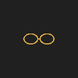
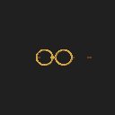
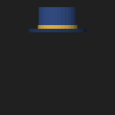
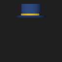

# 实验性刚性3D贴纸：2026-10-29

范围：FaceGeometry3D、MediaPipe显式三维输出、StickerMesh3D及内置眼镜/礼帽、ES3深度渲染、Demo贴纸弹框与恢复、既有参数/资源/授权消费者。新功能属于lib_beauty，可选包装，不增加SO或模型。API与已知边界见[SDK_3D_STICKERS](../../../SDK_3D_STICKERS.md)。

## 最终执行

| 检查 | 结果 | 证据 |
| --- | --- | --- |
| 核心Debug JVM | 143通过＋1按预期跳过 | results.json、compat-build.txt |
| 核心Release授权＋3D几何 | 20通过 | release-publication.txt、results.json |
| 资源/GPUPixel/feature JVM | 12/4/15通过 | final-ui-build.txt、gpupixel-jvm.txt、compat-build.txt |
| Pixel8 API36 Debug设备回归 | 14不同用例通过 | device-regression.txt |
| 最终UI竖屏1.0字体、横屏1.3字体 | 两配置通过，系统设置恢复 | ui-portrait.txt、ui-large-landscape.txt、ui-matrix.json |
| Demo构建、测试APK、lint | 通过，最终APK已覆盖安装Pixel8 | final-app-build.txt |
| 本地Maven五制品 | 通过 | release-publication.txt |
| 发布依赖契约 | 4项通过 | publication-contract.txt |
| 旧JVM签名保留 | 2300签名检查通过 | api-check.txt |
| 独立单入口消费者 | 三classpath、Debug/Release-R8/lint通过 | consumer.txt |

关键命令（Windows仓库根）：

```powershell
.\gradlew.bat :core:lib_beauty:testDebugUnitTest :feature:feature_app:testDebugUnitTest :app:assembleDebug :app:assembleDebugAndroidTest :app:lintDebug --max-workers=1 --console=plain
.\gradlew.bat :core:lib_beauty:testReleaseUnitTest --tests 'com.beautysdk.license.*' --tests com.beautysdk.Sticker3DTest publishBeautySdkToLocalBuildRepository --max-workers=1 --console=plain
.\gradlew.bat :core:lib_beauty_resources:testDebugUnitTest :core:lib_beauty_gpupixel:testDebugUnitTest --max-workers=1 --console=plain
.\gradlew.bat -p samples/standalone :app:verifyBeautySdkEntry :app:assembleDebug :app:assembleRelease :app:lintDebug -PrequireReleaseSigning=false --max-workers=1 --console=plain
python scripts/api_surface.py check
python scripts/test_entry_publication.py
```

设备使用明确指定的Pixel8执行，未操作另一台在线设备，不清空应用或用户资源。新设备类6项为真实ES3/真实模型，UI1项；原GpuPixelDeviceTest6项及FaceMotionDeviceTest1项保留原断言。设备命令为指定序列号的`adb shell am instrument -w -r -e class <四个测试类> com.beautysdk.demo.test/androidx.test.runner.AndroidJUnitRunner`，逐项名称见results.json。UI定位BottomSheet中控件；系统字体/旋转配置与用户偏好在finally恢复。

## 合成输出

以下仅为128×128合成灰底与人工三维关键点，不是真人人脸、性能或动态观感证据。镜腿由近似脸部深度遮挡，帽子为轴对称低多边形网格。

| 模型 | 正面 | yaw |
| --- | --- | --- |
| 眼镜 |  |  |
| 礼帽 |  |  |

## 失败尝试与限制

首次lint因values-en缺5项文案失败，补齐后通过。首次UI测试错误地在Activity根查找已移入弹窗的RadioGroup，修正测试定位后通过，没有删除可见性断言。一次错误选择Release全量旧Debug功能测试，在未配置发行授权下发生预期旁路与旧断言冲突，终止后以Release授权＋几何20项作为本轮有效范围；没有关闭发行授权或把全量Release写为通过。原始日志留在本机build/functional-test/sticker3d，不更新失败用例基线。

Release/R8为未正式签名构建，Debug设备开发授权不等于商业激活。未执行真人快速转头/俯仰、复杂遮挡画质、多设备长时性能、完整日夜/字体矩阵、实际直播引擎或iOS。CMS/旧ZIP协议未增加三维类型，不支持GLB/PBR/纹理/骨骼动画。旧JVM描述符保留检查不覆盖Kotlin元数据/native ABI或全部行为。

results.json记录工作区源文件摘要、未提交HEAD上下文、最终Debug APK SHA256和逐项通过名单。只推进本轮实测条目，历史用例记录保留；没有提交或远程发布。
